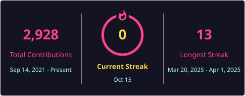
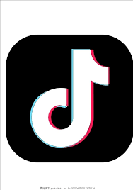
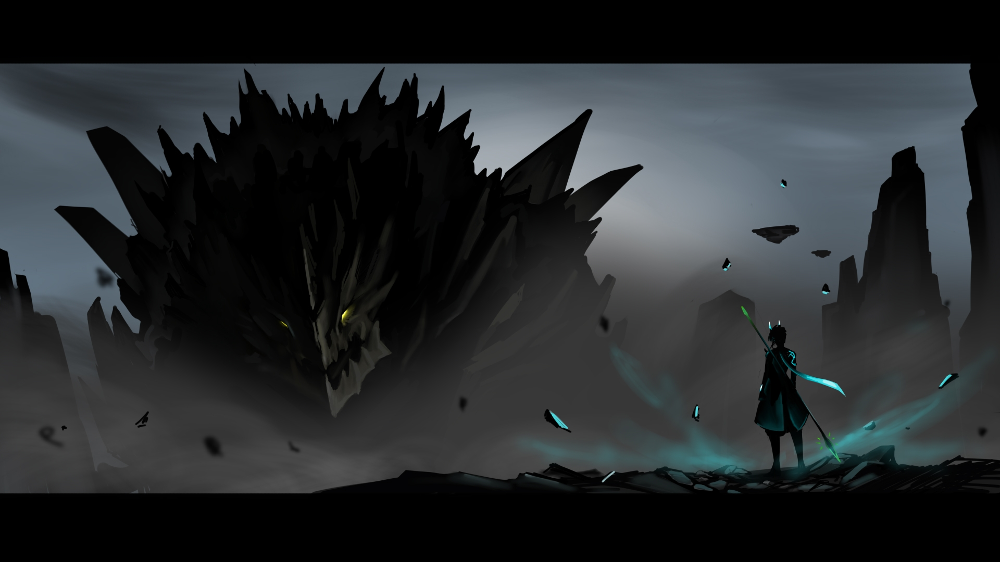

# 👋 你好，我是 YYLMZXC 😇

> 鱼跃龙门摘星辰

## 🎮 关于我
- **生存战争(Survivalcraft) 生态开发者**：维护 `SCAssistant`、`Survivalcraft_Server_DLL` 等工具
- **C#/.NET 跨平台开发者**：深耕 Uno Platform / Avalonia UI，兼顾 Go / Rust / Python
- **B站创作者**：分享游戏和编程相关内容
- **游戏玩家**：常玩生存战争、英雄联盟、王者荣耀、三角洲行动

## 🚀 我正在做什么
- 🛠️ 开发生存战争(Survivalcraft) 生态工具与插件
- 🌱 深入 C#/.NET 跨平台开发（Uno Platform、Avalonia）
- 🎯 探索游戏开发、图形编程与多平台同步工具链

## 💻 技术栈

### 编程语言

  

    🔷
    C#
  

  

    🐹
    Go
  

  

    🦀
    Rust
  

  

    🐍
    Python
  

  

    🔷
    TypeScript
  

  

    🌐
    HTML / CSS
  

### 框架与工具

  

    🧩
    Uno Platform
  

  

    🎨
    Avalonia UI
  

  

    🟣
    .NET
  

  

    🖥️
    Visual Studio / VS Code / Rider
  

  

    📦
    Git / GitHub / CNB / Gitee
  

## 📚 我的项目

| 项目 | 说明 | 技术 |
| --- | --- | --- |
| [SCAssistant](https://github.com/YYLMZXC/SCAssistant) | 生存战争(Survivalcraft) 助手工具 | C# |
| [survivalcraft-api](https://github.com/YYLMZXC/survivalcraft-api) | 生存战争插件 API | C# |
| [UnoBrowser](https://github.com/YYLMZXC/UnoBrowser) | 基于 Uno Platform 的跨平台浏览器 | C# |
| [screen-control](https://github.com/YYLMZXC/screen-control) | Windows 多屏关闭/控制小工具 | C# |
| [MultiGitCommit](https://github.com/YYLMZXC/MultiGitCommit) | 多平台(GitHub/CNB/Gitee)一键提交工具 | C# |
| [yylmzxcweb](https://github.com/YYLMZXC/yylmzxcweb) | 个人网站前端 | JavaScript |
| [yylmzxc.github.io](https://github.com/YYLMZXC/yylmzxc.github.io) | GitHub Pages 个人站点 | JavaScript |

> 更多仓库见我的 [GitHub 主页](https://github.com/YYLMZXC?tab=repositories)

## 📊 GitHub 统计
<!-- GitHub Stats Card -->

  
  
  

## 📫 联系我

  <a href="https://www.youtube.com/channel/UC9sSvoOdEGqmz4l1u4_YXVA" target="blank" style="display: flex; align-items: center; gap: 5px;">
    
    YouTube
  </a>
  <a href="https://space.bilibili.com/392592375" target="blank" style="display: flex; align-items: center; gap: 5px;">
    
    Bilibili
  </a>
  <a href="mailto:YYLMZXC@163.com" style="display: flex; align-items: center; gap: 5px;">
    
    163邮箱
  </a>
  <a href="https://gitee.com/yylmzxc" target="blank" style="display: flex; align-items: center; gap: 5px;">
    
    Gitee
  </a>
  <a href="https://v.douyin.com/YKRh4dM-A-4/" target="blank" style="display: flex; align-items: center; gap: 5px;">
    
    抖音
  </a>
  <a href="https://cnb.cool/u/YYLMZXC" target="blank" style="display: flex; align-items: center; gap: 5px;">
    
    CNB
  </a>

## 🌐 我的网站
- [博客](https://www.cnblogs.com/yylmzxc/) - 分享我的学习和项目经验
- [GitHub Pages](https://yylmzxc.github.io/) - GitHub Pages

## 🎨 个人形象

  

    
  

  

    
探索游戏与编程的奇妙世界 🌟

  

---

  <i>"代码是艺术，游戏是生活"</i> 👾

